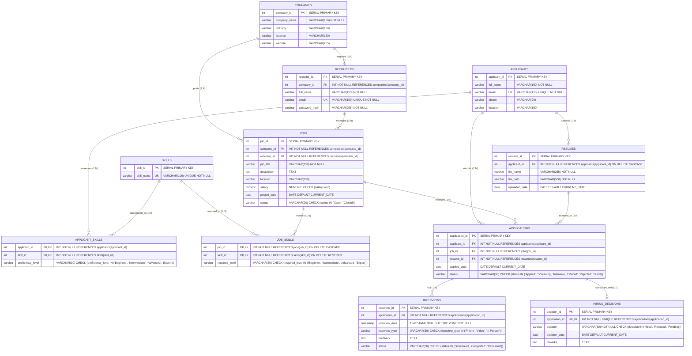

# RecruitTrack ATS — Entity-Relationship Diagram (ERD) Specification

**Course:** CIS 407 — Database Management Systems  
**Project:** RecruitTrack ATS (Job Recruitment and Applicant Tracking System)  
**Database System:** PostgreSQL 14.24  
**Database Name:** `recruittrack_db`  
**Host:** `localhost` | **Port:** `4919`  
**Live Schema Source of Truth:** 11 Relational Tables (10 Core Entities + `job_skills` Junction Table)  

---

## 1. Visual Artifact References

High-resolution printable and vector exports generated directly from the live PostgreSQL 14 schema:

- **High-Resolution PNG Diagram:** [RecruitTrack_ERD.png](file:///Users/nihtinroy/RecruitTrack-ATS/docs/RecruitTrack_ERD.png) (3800 × 2500 px, 300 DPI)
- **Printable PDF Diagram:** [RecruitTrack_ERD.pdf](file:///Users/nihtinroy/RecruitTrack-ATS/docs/RecruitTrack_ERD.pdf) (Vector document formatted for print and design reviews)

---

## 2. Complete Entity-Relationship Diagram (Crow's Foot Notation)

The following Mermaid ER diagram documents all 11 tables, actual column names, data types, primary keys, foreign keys, unique constraints, and cardinality relationships verified against the live PostgreSQL system catalog (`information_schema`).



---

## 3. Relationship Cardinalities and Integrity Rules

| # | Relationship | Parent Table | Child Table | Cardinality | Foreign Key Column | Action on Delete / Update | Business Rule & Purpose |
| :-: | :--- | :--- | :--- | :---: | :--- | :--- | :--- |
| **1** | **Employer Employs Recruiters** | `companies` | `recruiters` | **1 : N** | `recruiters.company_id` | `ON UPDATE NO ACTION`<br>`ON DELETE NO ACTION` | A company may employ one or more talent acquisition specialists. Recruiters must belong to an existing company. |
| **2** | **Employer Posts Job Openings** | `companies` | `jobs` | **1 : N** | `jobs.company_id` | `ON UPDATE NO ACTION`<br>`ON DELETE NO ACTION` | A client company can post multiple job requisitions over time. |
| **3** | **Recruiter Manages Job Postings** | `recruiters` | `jobs` | **1 : N** | `jobs.recruiter_id` | `ON UPDATE NO ACTION`<br>`ON DELETE NO ACTION` | A recruiter manages multiple job postings on behalf of their employer organization. |
| **4** | **Applicant Uploads Resumes** | `applicants` | `resumes` | **1 : N** | `resumes.applicant_id` | `ON UPDATE NO ACTION`<br>`ON DELETE CASCADE` | An applicant can maintain multiple document revisions (PDF/DOCX) on file. |
| **5** | **Applicant-to-Skill Endorsements** | `applicants` | `applicant_skills` | **1 : N** | `applicant_skills.applicant_id` | `ON UPDATE NO ACTION`<br>`ON DELETE NO ACTION` | Part 1 of the Candidate $\leftrightarrow$ Skill many-to-many relationship. Composite PK `{applicant_id, skill_id}` prevents duplicate endorsements. |
| **6** | **Skill Catalog Endorsement** | `skills` | `applicant_skills` | **1 : N** | `applicant_skills.skill_id` | `ON UPDATE NO ACTION`<br>`ON DELETE NO ACTION` | Part 2 of the Candidate $\leftrightarrow$ Skill many-to-many relationship. Enforces standardized technical naming. |
| **7** | **Job-to-Skill Requirements** | `jobs` | `job_skills` | **1 : N** | `job_skills.job_id` | `ON UPDATE NO ACTION`<br>`ON DELETE CASCADE` | Part 1 of the Job Requisition $\leftrightarrow$ Skill many-to-many relationship. Composite PK `{job_id, skill_id}` ensures distinct requirement mappings. |
| **8** | **Skill Catalog Requirement** | `skills` | `job_skills` | **1 : N** | `job_skills.skill_id` | `ON UPDATE NO ACTION`<br>`ON DELETE RESTRICT` | Part 2 of the Job Requisition $\leftrightarrow$ Skill many-to-many relationship. Prevents deleting skills that active job requisitions mandate. |
| **9** | **Candidate Submits Applications** | `applicants` | `applications` | **1 : N** | `applications.applicant_id` | `ON UPDATE NO ACTION`<br>`ON DELETE NO ACTION` | Part 1 of the Applicant $\leftrightarrow$ Job many-to-many relationship. Combined with `job_id`, `UNIQUE (applicant_id, job_id)` prevents duplicate applications. |
| **10** | **Job Receives Applications** | `jobs` | `applications` | **1 : N** | `applications.job_id` | `ON UPDATE NO ACTION`<br>`ON DELETE NO ACTION` | Part 2 of the Applicant $\leftrightarrow$ Job many-to-many relationship. Collects candidate pipeline submissions. |
| **11** | **Resume Attached to Application** | `resumes` | `applications` | **1 : N** | `applications.resume_id` | `ON UPDATE NO ACTION`<br>`ON DELETE NO ACTION` | Links the specific verified resume version evaluated for the requisition. |
| **12** | **Application Interview Stages** | `applications` | `interviews` | **1 : N** | `interviews.application_id` | `ON UPDATE NO ACTION`<br>`ON DELETE NO ACTION` | An active application can progress through multiple rounds (Phone Screen, Technical Video, Onsite). |
| **13** | **Application Final Hiring Decision** | `applications` | `hiring_decisions` | **1 : 1** | `hiring_decisions.application_id` | `ON UPDATE NO ACTION`<br>`ON DELETE NO ACTION` | Enforces a strict one-to-one conclusion via `UNIQUE (application_id)` on the child table. Exactly one formal outcome per application. |

---

## 4. Live Schema vs. Original SQL File Discrepancies

During Phase 2 live database inspection, the live PostgreSQL 14 catalog was cross-referenced with `database/schema.sql`. The following design extension was verified as the authoritative live schema:

1. **Addition of `job_skills` Junction Table:**
   - `schema.sql` originally defined 10 core tables (`companies`, `recruiters`, `applicants`, `jobs`, `skills`, `applicant_skills`, `resumes`, `applications`, `interviews`, `hiring_decisions`).
   - To support **transparent candidate skill matching** and SQL-driven match percentage calculations, the `job_skills` table was added to the live schema as the 11th table:
     ```sql
     CREATE TABLE IF NOT EXISTS job_skills (
         job_id INT NOT NULL REFERENCES jobs(job_id) ON DELETE CASCADE,
         skill_id INT NOT NULL REFERENCES skills(skill_id) ON DELETE RESTRICT,
         required_level VARCHAR(30) CHECK (required_level IN ('Beginner', 'Intermediate', 'Advanced', 'Expert')),
         CONSTRAINT pk_job_skills PRIMARY KEY (job_id, skill_id)
     );
     ```
   - This table allows job postings to mandate specific minimum competency levels, enabling the mathematical formula:
     $$\text{Match Percentage} = \text{ROUND}\left(100.0 \times \frac{\text{Matched Required Skills}}{\text{Total Job Required Skills}}, 1\right)$$

2. **Foreign Key Deletion Rules on Resumes & Job Skills:**
   - In `job_skills`, `job_id` has `ON DELETE CASCADE` to clean up mapped requirements when a job is removed, while `skill_id` has `ON DELETE RESTRICT` to protect master catalog integrity.
   - All other parent-child relationships use `NO ACTION` (RESTRICT) by default in PostgreSQL 14 to prevent accidental data loss in enterprise audit pipelines.
