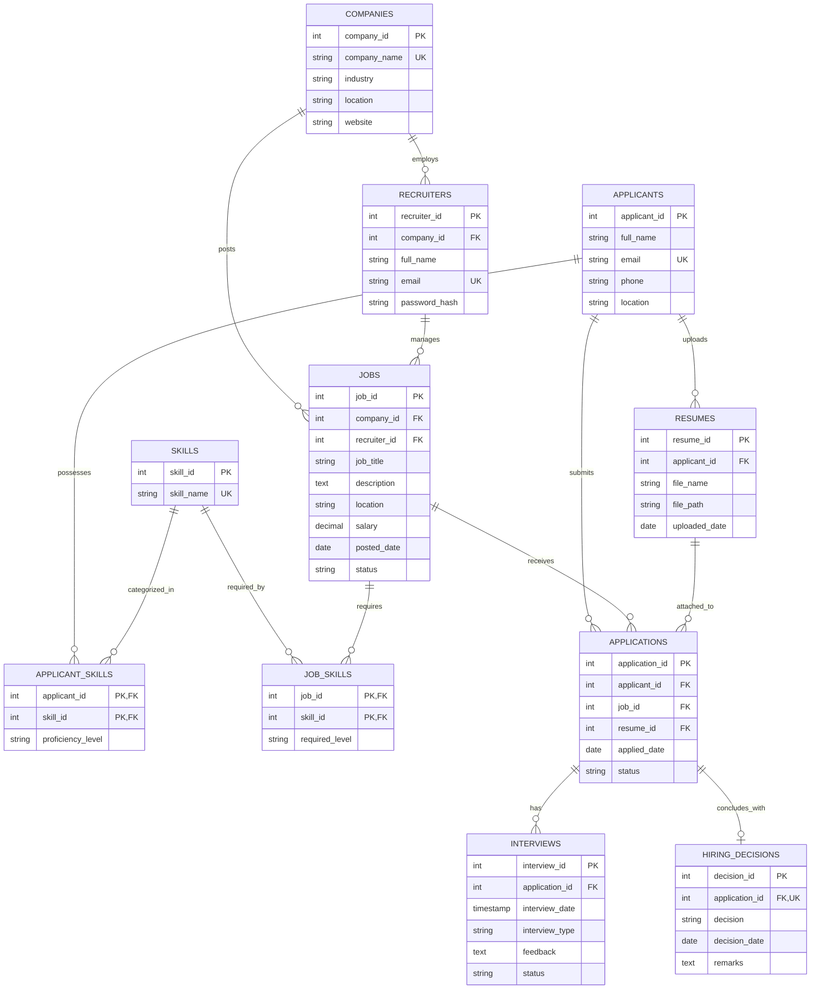

# RecruitTrack ATS — Job Recruitment and Applicant Tracking System

**Course:** CIS 407 — Database Management Systems  
**Project:** RecruitTrack ATS (Job Recruitment and Applicant Tracking System)  
**Platform:** macOS / Linux / Windows  
**Database Engine:** PostgreSQL 14 (Running on **Port 4919**)  
**Backend:** Python 3.13  
**UI & Analytics:** Streamlit, Pandas, Plotly  
**Security & ORM:** Parameterized Psycopg2-binary, Bcrypt Hashing, Dotenv  

---

## Table of Contents

1. [Project Introduction](#1-project-introduction)
2. [Problem Statement](#2-problem-statement)
3. [Project Objectives](#3-project-objectives)
4. [Functional Requirements](#4-functional-requirements)
5. [Business Rules](#5-business-rules)
6. [Database Design](#6-database-design)
7. [Entity-Relationship (ER) Diagram](#7-entity-relationship-er-diagram)
8. [Relational Schema](#8-relational-schema)
9. [Normalization Explanation (1NF, 2NF, 3NF)](#9-normalization-explanation)
10. [Description of All Tables](#10-description-of-all-tables)
11. [SQL Features Implemented](#11-sql-features-implemented)
12. [Python Architecture & Data Flow](#12-python-architecture--data-flow)
13. [Streamlit Interface & Module Overview](#13-streamlit-interface--module-overview)
14. [Installation Instructions](#14-installation-instructions)
15. [PostgreSQL Connection Instructions](#15-postgresql-connection-instructions)
16. [How to Run the Application](#16-how-to-run-the-application)
17. [Testing Procedures](#17-testing-procedures)
18. [Sample Screenshots & Interface Instructions](#18-sample-screenshots--interface-instructions)
19. [Limitations](#19-limitations)
20. [Future Improvements](#20-future-improvements)

---

## 1. Project Introduction

**RecruitTrack ATS** is a full-stack, enterprise-grade Applicant Tracking System built to model, manage, and optimize corporate recruitment pipelines. Engineered specifically for CIS 407 (Database Management Systems), this application demonstrates relational database design principles, Third Normal Form (3NF) normalization, multi-table transactional integrity, domain CHECK constraints, PL/pgSQL stored procedures, and parameterized query execution via a modern Python/Streamlit user interface.

Every transaction, calculation, and status transition in RecruitTrack ATS is backed by a live PostgreSQL 14 relational database. The architecture strictly avoids simulated frontend state or mock storage.

---

## 2. Problem Statement

Modern talent acquisition pipelines suffer from several database management challenges:
- **Disorganized Data Silos:** Candidate personal info, job openings, resumes, and interview feedback are frequently scattered across disconnected spreadsheets.
- **Referential Inconsistency:** Applications can be submitted without verifying whether the candidate actually owns the resume attached, or whether a recruiter is authorized to represent the hiring company.
- **Concurrency & Integrity Violations:** Duplicate applications, invalid status transitions (e.g., jumping from `Applied` straight to `Hired` without evaluation), and untracked interview changes degrade data quality.
- **Inefficient Talent Matching:** Recruiters lack transparent, queryable skill-matching mechanisms to rank candidates against specific technical job requisitions.

RecruitTrack ATS solves these issues by placing a strictly normalized PostgreSQL 14 relational engine at the core of all hiring workflows.

---

## 3. Project Objectives

1. Design and maintain a **10-table normalized relational schema** in Third Normal Form (3NF).
2. Enforce strict referential integrity using primary keys, composite foreign keys, unique constraints, and domain CHECK constraints.
3. Eliminate VS Code SQL diagnostics and validate all SQL statements against PostgreSQL 14 standards.
4. Implement advanced SQL features: multi-table joins, subqueries (`IN`, `NOT EXISTS`, scalar), aggregate metrics, database views, and PL/pgSQL stored procedures.
5. Provide a safe demonstration mechanism for DML operations (`INSERT`, `UPDATE`, `DELETE`) using explicit transaction blocks with `ROLLBACK`.
6. Implement transparent, SQL-based applicant-to-job skill matching and candidate ranking.
7. Deliver a modern, interactive Streamlit frontend connected to PostgreSQL on non-standard port `4919` using secure, non-hardcoded environment credentials.
8. Deliver automated test coverage verifying connectivity, CRUD operations, constraint enforcement, SQL injection defenses, and stored procedure execution.

---

## 4. Functional Requirements

- **Employer & Recruiter Management:** Register companies and recruiters with corporate email validation and verified company affiliations.
- **Job Requisition Posting:** Create, update, and manage job openings with compensation tracking and recruiter verification.
- **Candidate Registration:** Store applicant profiles, contact details, uploaded resume paths, and technical skill portfolios.
- **Skill Endorsements:** Maintain a master skill catalog and assign proficiencies (`Beginner`, `Intermediate`, `Advanced`, `Expert`) to candidates.
- **Application Submission:** Submit candidate applications, ensuring the attached resume belongs to the applicant and preventing duplicate applications for the same job requisition.
- **Pipeline Transitions:** Advance application stages (`Applied` &rarr; `Screening` &rarr; `Interview` &rarr; `Offered` &rarr; `Rejected` &rarr; `Hired`) via PL/pgSQL stored procedure.
- **Interview Scheduling:** Schedule interviews across multiple formats (`Phone`, `Video`, `In-Person`) and automatically synchronize application pipeline stages.
- **Hiring Decision Recording:** Log final hiring decisions with remarks and time-to-hire metrics, preventing duplicate decisions per application.
- **Candidate Ranking:** Perform relational skill matching between job requirements and applicant skill sets to score candidates by percentage.
- **Reporting & Exporting:** Render executive dashboards and export audit reports to CSV.

---

## 5. Business Rules

1. **Company-Recruiter Consistency:** A recruiter must belong to exactly one company. A job requisition's recruiter must belong to the exact company posting the job.
2. **Resume Ownership Integrity:** An application can only be submitted with a resume that was uploaded by and belongs to the applying candidate.
3. **Application Uniqueness:** An applicant cannot apply more than once to the same job requisition (`UNIQUE (applicant_id, job_id)`).
4. **Compensation Non-Negativity:** Job compensation must be greater than or equal to zero (`CHECK (salary >= 0)`).
5. **Controlled Status Domains:** Application statuses are constrained to: `'Applied'`, `'Screening'`, `'Interview'`, `'Offered'`, `'Rejected'`, `'Hired'`.
6. **One Final Decision:** Exactly one hiring decision record can be created per application (`UNIQUE (application_id)`).
7. **Secure Credential Handling:** Passwords must never be stored in plaintext. Passwords must be hashed using `bcrypt` with salt rounds. Placeholder demo hashes (`DEMO_HASH_*`) must be explicitly blocked from authentication until converted to valid bcrypt hashes.

---

## 6. Database Design

The database is built on **PostgreSQL 14** running on host `localhost` and port `4919`. It maintains referential integrity through foreign keys with explicit `ON DELETE RESTRICT` or `ON DELETE CASCADE` semantics depending on domain ownership.

### Architecture Highlights
- **10 Relational Tables:** Core domain entities covering the complete recruitment lifecycle.
- **1 Optional Extension Table (`job_skills`):** Normalizes job skill requirements to support candidate ranking without altering core table cardinalities.
- **4 Performance B-Tree Indexes:** Accelerating foreign key filtering and date searches.
- **2 Reporting Views:** Denormalizing frequent multi-table reporting joins.
- **2 PL/pgSQL Stored Procedures:** Encapsulating stateful status transitions and interview scheduling.

---

## 7. Entity-Relationship (ER) Diagram



---

## 8. Relational Schema

```text
COMPANIES (
    company_id [PK],
    company_name [UNIQUE, NOT NULL],
    industry [NOT NULL],
    location,
    website
)

RECRUITERS (
    recruiter_id [PK],
    company_id [FK -> COMPANIES.company_id],
    full_name [NOT NULL],
    email [UNIQUE, NOT NULL],
    password_hash [NOT NULL],
    UNIQUE (recruiter_id, company_id)
)

APPLICANTS (
    applicant_id [PK],
    full_name [NOT NULL],
    email [UNIQUE, NOT NULL],
    phone,
    location
)

JOBS (
    job_id [PK],
    company_id [FK -> COMPANIES.company_id],
    recruiter_id [FK -> RECRUITERS.recruiter_id],
    job_title [NOT NULL],
    description,
    location,
    salary [CHECK (salary >= 0)],
    posted_date,
    status [CHECK (status IN ('Open', 'Closed'))],
    FK (recruiter_id, company_id) -> RECRUITERS(recruiter_id, company_id)
)

SKILLS (
    skill_id [PK],
    skill_name [UNIQUE, NOT NULL]
)

APPLICANT_SKILLS (
    applicant_id [PK, FK -> APPLICANTS.applicant_id],
    skill_id [PK, FK -> SKILLS.skill_id],
    proficiency_level [CHECK (proficiency_level IN ('Beginner', 'Intermediate', 'Advanced', 'Expert'))]
)

JOB_SKILLS (
    job_id [PK, FK -> JOBS.job_id],
    skill_id [PK, FK -> SKILLS.skill_id],
    required_level [CHECK (required_level IN ('Beginner', 'Intermediate', 'Advanced', 'Expert'))]
)

RESUMES (
    resume_id [PK],
    applicant_id [FK -> APPLICANTS.applicant_id],
    file_name [NOT NULL],
    file_path [NOT NULL],
    uploaded_date,
    UNIQUE (resume_id, applicant_id)
)

APPLICATIONS (
    application_id [PK],
    applicant_id [FK -> APPLICANTS.applicant_id],
    job_id [FK -> JOBS.job_id],
    resume_id [FK -> RESUMES.resume_id],
    applied_date,
    status [CHECK (status IN ('Applied', 'Screening', 'Interview', 'Offered', 'Rejected', 'Hired'))],
    UNIQUE (applicant_id, job_id),
    FK (resume_id, applicant_id) -> RESUMES(resume_id, applicant_id)
)

INTERVIEWS (
    interview_id [PK],
    application_id [FK -> APPLICATIONS.application_id],
    interview_date [NOT NULL],
    interview_type [CHECK (interview_type IN ('Phone', 'Video', 'In-Person'))],
    feedback,
    status [CHECK (status IN ('Scheduled', 'Completed', 'Cancelled'))]
)

HIRING_DECISIONS (
    decision_id [PK],
    application_id [FK -> APPLICATIONS.application_id, UNIQUE],
    decision [CHECK (decision IN ('Hired', 'Rejected', 'Pending'))],
    decision_date,
    remarks
)
```

---

## 9. Normalization Explanation

The RecruitTrack ATS database was designed following standard relational database normalization methodologies:

### First Normal Form (1NF)
- **Atomic Values:** Every column holds a single scalar value. Multi-valued fields (e.g. multiple skills for a candidate) are factored out into junction tables (`applicant_skills`, `job_skills`).
- **Unique Records:** Each table has a defined primary key (`company_id`, `recruiter_id`, `applicant_id`, etc.).
- **No Repeating Groups:** Instead of having columns like `skill_1`, `skill_2`, or `resume_1`, separate related tables store one record per entity instance.

### Second Normal Form (2NF)
- **1NF Compliance:** The database strictly satisfies 1NF.
- **No Partial Key Dependencies:** In composite-key junction tables (`applicant_skills` on `{applicant_id, skill_id}`, and `job_skills` on `{job_id, skill_id}`), all non-key attributes (`proficiency_level`, `required_level`) depend on the full composite key, not on a subset of it.

### Third Normal Form (3NF)
- **2NF Compliance:** The database strictly satisfies 2NF.
- **No Transitive Dependencies:** Non-prime attributes depend only on the primary key ($X \rightarrow Y$ where $X$ is a superkey). For example, candidate name and email are stored exclusively in `applicants`. The `applications` table stores only `applicant_id` and does not duplicate applicant demographic details, preventing update and deletion anomalies.

---

## 10. Description of All Tables

1. **`companies`:** Stores corporate employer entities posting positions.
2. **`recruiters`:** Stores hiring managers and talent acquisition staff, linked to employer companies.
3. **`applicants`:** Master table for candidate personal and contact profiles.
4. **`jobs`:** Contains job requisitions with title, description, location, salary, and status.
5. **`skills`:** Master technical competency dictionary (Python, SQL, AWS, Docker, etc.).
6. **`applicant_skills`:** Many-to-many junction table mapping applicants to their skills and proficiency levels.
7. **`resumes`:** Tracks uploaded resume documents belonging to candidates.
8. **`applications`:** Central junction entity connecting applicants, job requisitions, and submitted resumes.
9. **`interviews`:** Logs scheduled, completed, and cancelled interview stages with recruiter feedback.
10. **`hiring_decisions`:** Records the final hiring outcome, remarks, and audit dates for each application.
11. **`job_skills` (Extension):** Normalized many-to-many junction table defining required skills for job postings.

---

## 11. SQL Features Implemented

All required CIS 407 SQL constructs are fully implemented in `database/queries.sql` and verified against PostgreSQL 14:

| Feature Category | Implementation in `database/queries.sql` |
|---|---|
| **Basic SELECT / WHERE / ORDER BY** | Queries 1 & 2: Applicant listings and salary/status filtering |
| **Two-Table INNER JOIN** | Query 3: Jobs joined with employer companies and recruiters |
| **Four-Table INNER JOIN** | Query 4: Applications, applicants, jobs, companies, and resumes |
| **LEFT JOIN** | Query 5: All jobs including those with zero applications |
| **Many-to-Many JOIN** | Query 6: Applicant skills and proficiency matrix |
| **COUNT & GROUP BY** | Query 7: Application conversion counts and percentages by status |
| **AVG, MIN, MAX** | Query 8: Statistical salary distribution across job postings |
| **HAVING Clause** | Query 9: High-volume jobs with more than one application |
| **IN Subquery** | Query 10: Candidates with specific skill competencies (e.g. Python) |
| **Scalar Subquery** | Query 11: Job openings offering compensation strictly above average |
| **NOT EXISTS Subquery** | Query 12: Candidates who have registered but not yet applied |
| **Complex Recruitment Pipeline** | Query 13: Full interview schedule audit log with applicant/job data |
| **Time-to-Hire Analytics** | Query 14: Decision timeline calculation `(decision_date - applied_date)` |
| **Executive Metric Aggregation** | Query 15: Single-row 7-metric dashboard query |
| **Candidate Ranking Query** | Query 16: Percentage skill-match scoring between jobs and applicants |
| **Safe DML (INSERT, UPDATE, DELETE)** | Demos 1–3: Explicit `BEGIN ... ROLLBACK;` transaction demonstrations |
| **PostgreSQL Views** | `applicant_application_view`, `recruitment_summary_view` |
| **B-Tree Indexes** | `idx_applications_applicant`, `idx_applications_job`, `idx_applications_status`, `idx_interviews_date` |
| **PL/pgSQL Stored Procedures** | `update_application_status` & `schedule_interview` |

---

## 12. Python Architecture & Data Flow

RecruitTrack ATS follows a clean, decoupled 3-tier architectural model:

```text
┌────────────────────────────────────────────────────────┐
│                   STREAMLIT UI TIER                    │
│   (Dashboard, Forms, CRUD Panels, Plotly Visuals)     │
└──────────────────────────┬─────────────────────────────┘
                           │ User Input & Parameters
                           ▼
┌────────────────────────────────────────────────────────┐
│                 PYTHON BACKEND TIER                    │
│  (apps/db_connection.py, Bcrypt Auth, Data Parsing)    │
└──────────────────────────┬─────────────────────────────┘
                           │ Parameterized SQL / CALL Stored Procs
                           ▼
┌────────────────────────────────────────────────────────┐
│               POSTGRESQL 14 DATABASE                   │
│   (Port 4919, Tables, Constraints, Views, Procedures)  │
└──────────────────────────┬─────────────────────────────┘
                           │ Relational Result Sets / Rowcounts
                           ▼
┌────────────────────────────────────────────────────────┐
│             RESULTS RENDERED IN STREAMLIT              │
└────────────────────────────────────────────────────────┘
```

### Complete End-to-End Workflow:
1. **User Interaction (Streamlit UI):** Recruiter updates an application's stage to `'Offered'` or schedules an interview.
2. **Python Logic Layer (`apps/db_connection.py`):** Wraps parameters in tuples, prevents SQL injection, opens a connection from `get_connection()`, and invokes `execute_procedure()`.
3. **Database Execution (PostgreSQL 14):** Executes `CALL update_application_status(1, 'Offered');`. PL/pgSQL checks validity, raises an exception if invalid, updates the row, and commits.
4. **Display:** Streamlit receives execution confirmation, reloads relational data via `SELECT`, and updates the UI live.

---

## 13. Streamlit Interface & Module Overview

The application features 10 comprehensive interface sections:

1. **Dashboard:** 7 real-time KPI cards (Companies, Recruiters, Applicants, Jobs, Applications, Interviews, Hired Candidates) and 4 Plotly charts.
2. **Companies Management:** Search, add, update, and safely delete corporate employers with foreign key validation.
3. **Jobs Management:** Post new jobs with salary and location, enforcing that selected recruiters belong to the posting company.
4. **Applicants Management:** Register candidates, view attached resumes, and inspect skill portfolios.
5. **Skills Management:** Master skills catalog, candidate proficiency assignments, and full skills matrix view.
6. **Applications Management:** Submit applications (enforcing that candidate owns the selected resume), filter by status, and update statuses using the PL/pgSQL stored procedure.
7. **Interviews Management:** Schedule interviews via stored procedure and log evaluation feedback.
8. **Hiring Decisions:** Record final hiring outcomes, preventing duplicate decisions per application.
9. **Candidate Skill Matching:** Transparent SQL-based candidate ranking engine comparing candidate skills with job requisitions.
10. **Reports & Analytics:** Access database views (`applicant_application_view`, `recruitment_summary_view`), salary statistics, and one-click CSV report exports.

---

## 14. Installation Instructions

### Prerequisites
- macOS, Linux, or Windows
- Python 3.10+ (Tested on Python 3.13)
- PostgreSQL 14 running on **Port 4919**

### Setup Steps

1. **Open Workspace Directory:**
   ```bash
   cd /Users/nihtinroy/RecruitTrack-ATS
   ```

2. **Create Python Virtual Environment:**
   ```bash
   python3 -m venv .venv
   ```

3. **Activate Virtual Environment:**
   ```bash
   source .venv/bin/activate
   ```

4. **Install Dependencies:**
   ```bash
   pip install -r requirements.txt
   ```

---

## 15. PostgreSQL Connection Instructions

1. **Copy the Environment Configuration File:**
   ```bash
   cp .env.example .env
   ```

2. **Edit `.env` with Your PostgreSQL Credentials:**
   ```ini
   DB_HOST=localhost
   DB_PORT=4919
   DB_NAME=recruittrack_db
   DB_USER=postgres
   DB_PASSWORD=your_actual_postgres_password
   ```

3. **Verify Database Connectivity:**
   Test connection using the built-in Python helper:
   ```bash
   .venv/bin/python3 -c "from apps.db_connection import test_connection; print(test_connection())"
   ```

---

## 16. How to Run the Application

With the virtual environment active and `.env` configured:

```bash
.venv/bin/streamlit run apps/main.py
```

The application will launch in your browser at:
`http://localhost:8501`

---

## 17. Testing Procedures

RecruitTrack ATS includes an automated `pytest` test suite covering:
- Database connectivity on port 4919
- Password hashing and verification via `bcrypt`
- Rejection of demo placeholder hashes (`DEMO_HASH_*`)
- Parameterized query injection defense
- Algorithmic skill matching logic
- Unique constraints (`applicants(email)`, `applications(applicant_id, job_id)`)
- Domain CHECK constraints (negative salary, invalid application status)
- Transaction safety and `ROLLBACK` verification
- PL/pgSQL stored procedure exception handling

### Run the Test Suite:
```bash
.venv/bin/pytest tests/ -v
```

---

## 18. Sample Screenshots & Interface Instructions

When demonstrating the application:

1. **Recruiter Authentication (Sidebar):**
   - Click **Demo Account Setup** in the sidebar.
   - Select `sarah.johnson@example.com` and click **Set Bcrypt Password** (sets password to `DemoPass123!`).
   - Sign in with `sarah.johnson@example.com` / `DemoPass123!`.
2. **Dashboard Review:**
   - Review live metrics and Plotly charts for application conversion and job distribution.
3. **Submit an Application:**
   - Navigate to **Applications Management** &rarr; **Submit Application**.
   - Select an applicant, an open job, and the applicant's verified resume. Click **Submit Application**.
4. **Execute Stored Procedure:**
   - Switch to **Update Application Status (Stored Procedure)**.
   - Select the newly created application and transition status to `Interview`.
5. **Schedule an Interview:**
   - Go to **Interviews Management** &rarr; **Schedule New Interview**.
   - Pick the application, set date/time, and click **Schedule Interview**.
6. **Record Final Hiring Decision:**
   - Navigate to **Hiring Decisions** &rarr; **Record Decision**.
   - Select the application, set decision to `Hired`, and submit.
7. **Review Exportable Reports:**
   - Navigate to **Reports & Analytics** &rarr; **Company Recruitment Summary**.
   - Click **Download Report CSV** to verify live database export.

---

## 19. Limitations

1. **Local Storage of Resumes:** Resume file paths are managed as server-side references (`uploads/resumes/`) rather than an Amazon S3 or Google Cloud Storage bucket.
2. **Port 4919 Assumption:** PostgreSQL is configured to listen on port `4919`. In default PostgreSQL environments, port `5432` is standard; port `4919` is required for this specific university environment.
3. **Session-Based Authentication:** Recruiter sessions reside in Streamlit memory rather than an encrypted JWT cookie or external OAuth provider.

---

## 20. Future Improvements

1. **Automated Notification Triggers:** Add PostgreSQL row triggers to send email notifications when application status transitions to `Offered` or `Rejected`.
2. **Resume Text Parsing:** Integrate a Python document extraction pipeline to automatically parse candidate skills from uploaded PDF resumes into `applicant_skills`.
3. **Two-Factor Authentication (2FA):** Add TOTP-based multi-factor authentication for recruiter accounts.
4. **Dockerized Deployment:** Package PostgreSQL 14 and the Streamlit app into a multi-container `docker-compose.yml` for zero-configuration local deployment.
